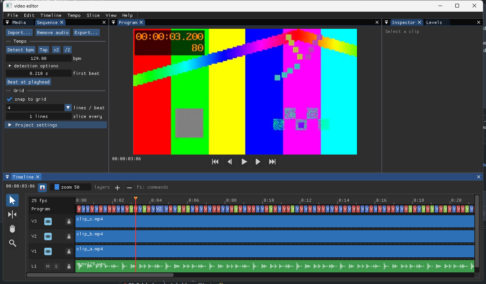

# Video Editor

A small video editor for music videos. It cuts clips to the beat of a song.



## Features

- Import video and audio. Use **Import** (`ctrl+i`) or drop files on the window.
- Detect the bpm. Pick another candidate or tap the tempo if the result is wrong.
- Show a beat grid. Cuts and clips snap to it. Hold `alt` to turn snapping off.
- Make patterns. A pattern is a loop of hits on the grid, like a drum machine. Each hit makes a cut.
- Paint parts. A part is a time range with a pattern. Cuts update when you paint, move, resize, duplicate, or split a part.
- Show one video layer at a time. The program row shows which layer is visible.
- Randomize. It fills each slice of the rhythm with your footage on a new layer.
- Lock clips and slices (`k`). Locked slices stay when you randomize again.
- Roll the mouse wheel on a slice to reroll it. The wheel does not lock.
- Add lyrics. Edit text and times. Align them from the song. Burn them into the export. Import and export SRT, LRC, ASS, and TXT.
- Make smooth slow motion with RIFE. Enhance and upscale with Real-ESRGAN.
- Set the output size, a mask (fake borders, for example 9:16 in a 16:9 project), and the background color.
- Run long jobs in the background. A window shows the progress. **Cancel** stops the job.
- Export to mp4, mkv, webm, or mov. Choose the quality: typical, high (default), or max.
- Use undo and redo. Press **F1** to search all commands.

## Workflow

1. Import your clips and your song.
2. Press **Remove audio** (`shift+delete`) to remove the sound of the clips.
3. Select the song. Press **Detect bpm** (`t`). Press **Beat at playhead** (`shift+h`) if the grid is off the beat.
4. Open **Patterns** (`shift+p`). Press **New**. Click steps to make hits.
5. Set each lane to a layer (V1, V2, ...) or to `mark`. A `mark` only makes a cut.
6. Pick a pattern in the **brush** strip. Paint parts in the **Parts** row:
   - Drag on empty space to paint a part. Painting over a part cuts it. The rest stays.
   - Drag the top strip of a part to move it. Drag an edge to cut or extend it. The pattern stays in place.
   - Double-click a part to type its start, end, and length. Double-click free space to fill the gap.
   - Press `ctrl+d` to duplicate a part. Press `s` to split it at the playhead.
   - Right-click a part to change its pattern.
   - Press **Apply pattern** (`p`) only when you use no parts.
7. Select a range in the program row. Press `ctrl+c`, `ctrl+v`, or `ctrl+r` to copy, paste, or repeat it. Press `ctrl+l` to loop it.
8. Open **Randomize options** (`shift+r`). Press **Randomize** (`r`).
   - **slice at** sets the slices: cuts, pattern, or grid.
   - **footage** sets the source: same time, in order, or any piece.
   - **spread clips evenly** (default) shows every clip at the same rate over the whole video.
   - **max in a row** limits repeats of one clip.
9. Lock the slices you like (`k`). Randomize again. Only the other slices change.
10. For lyrics, press **Lyrics** (`shift+y`). Paste the text. Press **Auto-align** or **Tap** (`y`).
11. Press **Export** (`ctrl+e`).

## Timeline

- `ctrl+wheel` zooms in time. `alt+wheel` changes the height of the lanes.
- The ruler stays at the top when you scroll.
- Middle mouse button pans.

## Build

You need:

- Windows 10 or 11
- The [Odin compiler](https://odin-lang.org)
- `ffmpeg` and `ffprobe` in your `PATH`

```
git clone --recurse-submodules https://github.com/areynaldo/video_editor.git
cd video_editor
.\setup.ps1
odin build . -out:editor.exe
editor.exe
```

`setup.ps1` runs one time. It fixes the Dear ImGui bindings (see **Notes**).

## Export

Choose the **quality** in Project settings:

| Quality | Video | Audio |
|---|---|---|
| typical | x264 crf 19 | aac 192k |
| high (default) | x264 crf 16, slow | aac 256k |
| max | x264 crf 12, slow (big files) | aac 320k |

WebM uses VP9 and Opus. The export reads the original files at full size. The preview uses small frames (960x540).

## Slow motion and enhance (optional)

Put the tools in `tools\` or in your `PATH`:

- `rife-ncnn-vulkan.exe` with a model folder such as `rife-v4.6`.
- `realesrgan-ncnn-vulkan.exe` with its `models` folder.

Select clips. Press **Smooth slow-mo**. Set the speed in percent or the new length. Press **Apply and render**.

- RIFE reads the source frames without resampling. This keeps the motion smooth.
- Frames larger than the project are shrunk before RIFE. Smaller frames stay as they are.
- Frames are PNG. The result is x264 crf 12. The files are in `cache\`.
- **Slow-mo + enhance** denoises, interpolates, and upscales. It skips upscaling when the source is as big as the project.
- Without RIFE, ffmpeg `minterpolate` makes the frames. It is slower and has more errors.
- Real-ESRGAN uses `realesr-general-x4v3` if present. Otherwise it uses `realesr-animevideov3` (made for anime).
- Write a GPU number in `tools\gpu.txt` if the wrong GPU is used.
- If the GPU runs out of memory, the editor tries again with one frame at a time.

## Align lyrics (optional)

Open **Lyrics** and **auto-align setup**. Choose an engine:

- **whisper listens** (default). It uses [whisper.cpp](https://github.com/ggml-org/whisper.cpp). Put `whisper-cli.exe` in `tools\`. Set a ggml model and the language.
- **whisper aligns your words**. It uses [stable-ts](https://github.com/jianfch/stable-ts) through [uv](https://docs.astral.sh/uv/).
- **voice model (CTC)**. It uses `scripts/ctc_emissions.py` through uv. The first run downloads about 2 GB.

Select the song. Press **Auto-align**. Check the lines in the Lyrics row. Use **Tap** or drag lines to fix them.

- **vocals only** with a separator command gives better results. Example with uv:
  `uv tool run --python 3.12 --from "audio-separator[cpu]" --with audioread audio-separator {in} --output_dir {dir} --single_stem Vocals --model_filename UVR-MDX-NET-Voc_FT.onnx --output_format WAV`
- **Transcribe** writes the lyrics from what whisper hears. It replaces the existing lines.
- After a run, `lyrics_align_debug.txt` shows the heard words and the line times.
- `scripts\diagnose.py` tests each stage outside the editor.

## When a job fails

A **Problem** window shows the full text of the error. Press **Copy** to take it. The text is also in `last_job_error.txt`.

## Files

| File | Use |
|---|---|
| `*.vproj` | Project file (plain text). |
| `keybindings.ini` | All keys. Press `F5` to reload it. |
| `cache\` | Rendered slow-mo and enhance files. You can delete it. |
| `imgui.ini` | Window layout. Use **View > Reset layout** to restore it. |
| `whisper.txt` | Auto-align settings. |

## Notes

- Export opens one ffmpeg input for each clip. Many small clips make it slow. Use slices of one beat or more.
- `deps/odin-imgui` is a Git submodule (`gitlab.com/L-4/odin-imgui`).
- The bindings have one error in `imgui_impl_opengl3/imgui_impl_opengl3.odin`. `patches/odin-imgui-opengl3.patch` fixes it. `setup.ps1` applies it.
